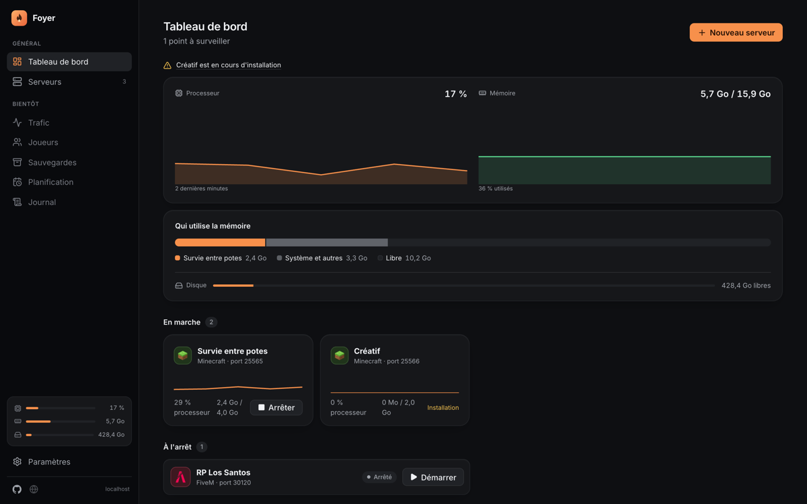
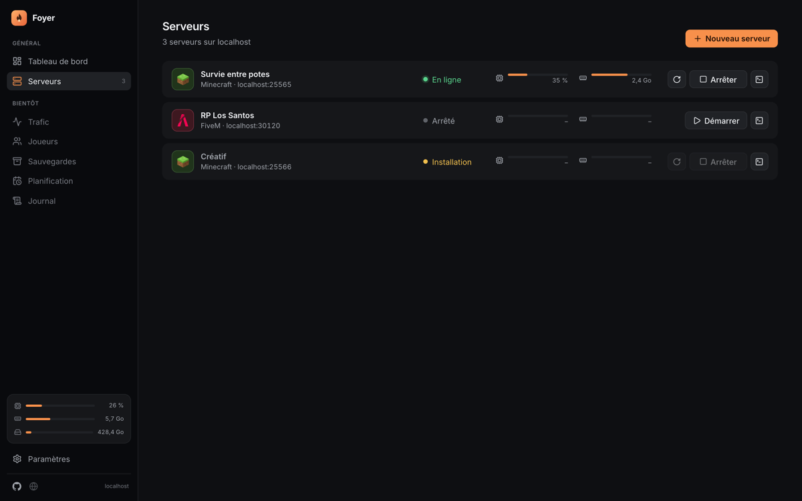
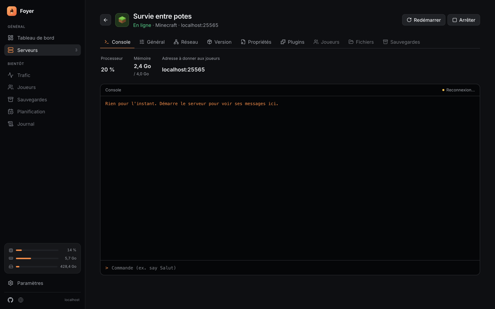
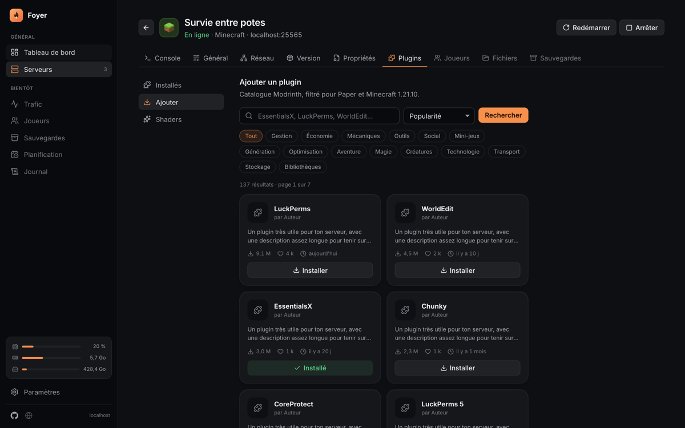
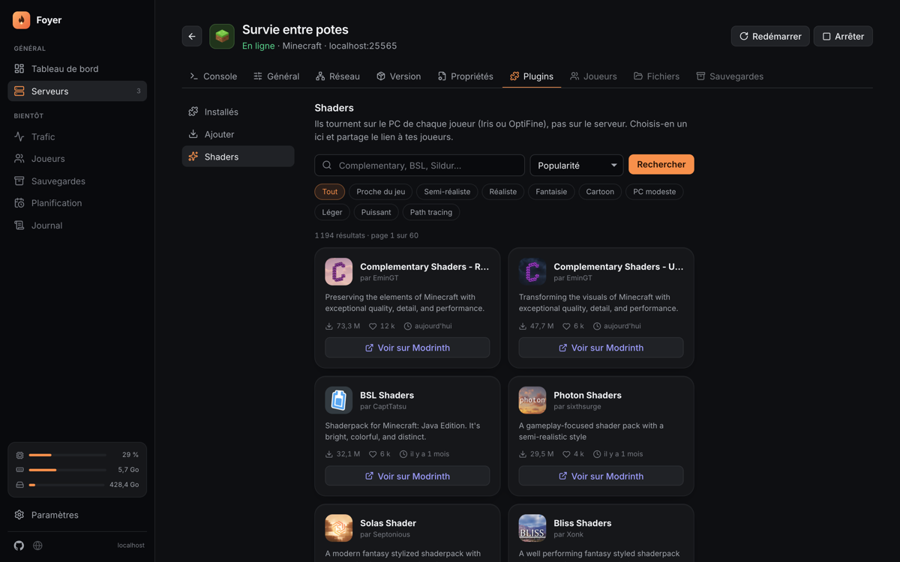
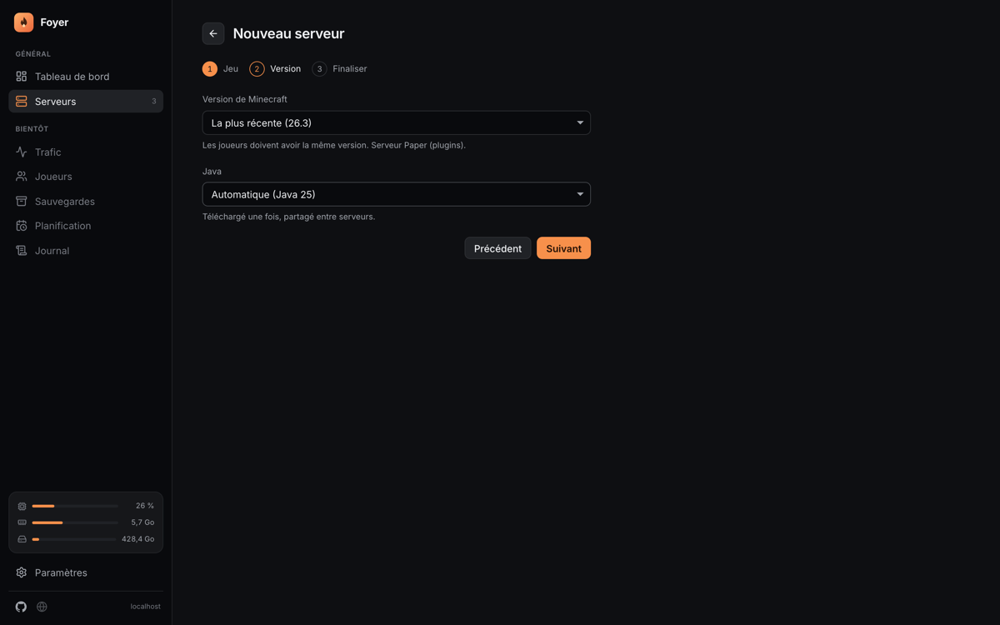
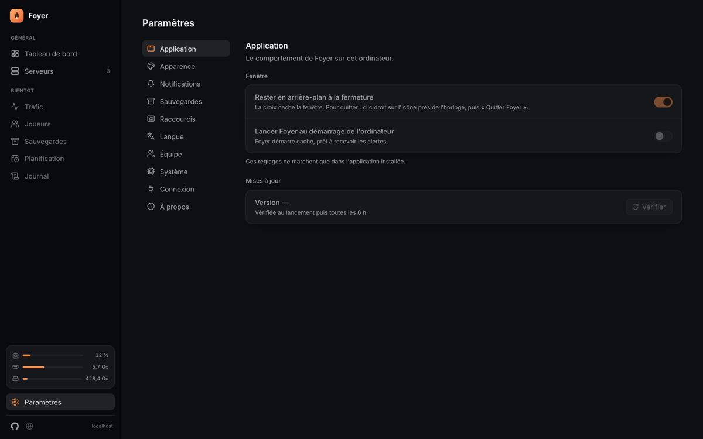

<p align="center">
  
</p>

<h1 align="center">Foyer</h1>

<p align="center">
  <strong>Gestor de servidores de juegos autoalojados para Windows y Linux.</strong><br>
  Instala, ejecuta y supervisa tus servidores de juegos desde una aplicación de escritorio clara.
</p>

<p align="center">
  <a href="README.md">English</a> · <a href="README.fr.md">Français</a> · <strong>Español</strong>
</p>

<p align="center">
  <a href="https://github.com/arayan48/foyer/releases/latest"></a>
  <a href="LICENSE"></a>
  
  
</p>

<p align="center">
  
</p>

---

## Descripción

Foyer convierte cualquier máquina Windows o Linux en un host de servidores de juegos, sin archivos de configuración ni línea de comandos. Un **agente** ligero escrito en Rust hace el trabajo en la máquina. Una **aplicación de escritorio** (Tauri + Svelte) ofrece un panel, consolas en vivo y los ajustes de cada servidor.

### Juegos compatibles

| Juego | Estado | Origen |
|---|---|---|
| Minecraft (Paper) | ✅ Compatible | PaperMC, última versión estable + Java 25 (Adoptium) |
| FiveM (txAdmin) | ✅ Compatible | Build oficial «recommended» |
| Más juegos | 🗺️ Previsto | Foyer usa un sistema de recetas pensado para nuevos juegos, ver [ROADMAP.md](ROADMAP.md) |

## Funciones

- **Instalación en un clic**: descarga el servidor del juego y lo que necesita, listo para arrancar.
- **Ciclo de vida completo**: iniciar, detener y reiniciar, con apagado limpio y limpieza de procesos.
- **Plugins**: catálogo de Modrinth en la aplicación, filtros por categoría, orden por popularidad o fecha; instala, activa y elimina plugins de Paper.
- **Shaders**: explora los shaders de Modrinth y compártelos con tus jugadores.
- **Consola en vivo**: registros y comandos en tiempo real por WebSocket.
- **Supervisión**: CPU y memoria por servidor; CPU, memoria y disco de la máquina.
- **Fiabilidad**: arranque con la máquina, reinicio tras un fallo (3 intentos cada 10 min).
- **Límites de recursos**: topes de memoria y CPU por servidor.
- **Cortafuegos gestionado**: puertos abiertos y cerrados automáticamente.
- **Seguro por defecto**: HTTPS con certificado autofirmado fijado, token en cada ruta.
- **Remoto o local**: gestiona la máquina desde otro PC o directamente en el servidor.

## Capturas de pantalla

> Por ahora la interfaz está en francés. El inglés y el español están previstos.

| | |
|---|---|
|  |  |
| **Servidores**: estado, CPU y memoria de un vistazo | **Consola**: registros y comandos en tiempo real |
|  |  |
| **Plugins**: catálogo de Modrinth con filtros y páginas | **Shaders**: elige uno para tus jugadores |
|  |  |
| **Nuevo servidor**: juego, versión y listo | **Ajustes**: aplicación, actualizaciones, máquina |

## Arquitectura

```
  Tu PC                                 Máquina servidor
 ┌──────────────────┐   HTTPS + WSS    ┌───────────────────────────────────┐
 │  App Foyer       │ ───────────────▶ │  foyer-agent (puerto 7878)        │
 │  Tauri + Svelte  │   token Bearer   │   ├─ API REST  /api/...           │
 └──────────────────┘   cert. fijado   │   ├─ consola WebSocket            │
                                       │   ├─ estadísticas de sistema      │
                                       │   └─ servidores de juego          │
                                       └───────────────────────────────────┘
```

| Componente | Carpeta | Tecnologías |
|---|---|---|
| Agente | [`agent/`](agent) | Rust, axum, rustls |
| Aplicación | [`app/`](app) | Tauri 2, Svelte 5, TypeScript |

Todos los detalles (en francés): [docs/ARCHITECTURE.md](docs/ARCHITECTURE.md).

## Instalación

Descarga desde la [última versión](https://github.com/arayan48/foyer/releases/latest):

| Instalador | Dónde instalarlo | Contenido |
|---|---|---|
| `Foyer-Serveur.exe` | La máquina que aloja los juegos | App + agente, servicio de arranque, regla de cortafuegos |
| `Foyer-Client.exe` | Cualquier PC desde el que gestiones | Solo la app, sin permisos de administrador |

**Primera conexión:** introduce la dirección de la máquina y el token de `C:\Foyer\token`. Antes de aceptar, compara la huella que muestra la app con `C:\Foyer\fingerprint` en la máquina.

## Seguridad

- Todo el tráfico va cifrado (TLS) y la app fija el certificado del agente.
- Cada ruta, WebSocket incluido, exige el token en la cabecera `Authorization`.
- **Nunca expongas el puerto 7878 a Internet.** Para jugar o gestionar a distancia, usa una VPN o un túnel como playit.gg.

## Configuración

| Variable | Por defecto | Uso |
|---|---|---|
| `FOYER_DATA` | `C:\Foyer` / `/var/lib/foyer` | Carpeta de datos (token, certificado, servidores) |
| `FOYER_ADDR` | `0.0.0.0:7878` | Dirección de escucha del agente |

## Compilar desde el código

**Agente**

```bash
cd agent
cargo build --release                                  # Linux
cargo build --release --target x86_64-pc-windows-gnu   # Windows (cruzado, mingw-w64)
```

**Aplicación**

```bash
cd app
npm install
npx tauri build                                                     # plataforma actual
npx tauri build --runner cargo-xwin --target x86_64-pc-windows-msvc # Windows desde Linux
```

**Trabajar la interfaz sin servidor**

```bash
cd app
node mock-agent.mjs   # agente falso, token: test
npx vite
```

## Hoja de ruta

Próximamente: copias de seguridad y tareas programadas, gestión de jugadores, análisis de tráfico, mods y más juegos. Ver [docs/PLAN.md](docs/PLAN.md) y [ROADMAP.md](ROADMAP.md).

## Contribuir

Los errores y las ideas son bienvenidos en [Issues](https://github.com/arayan48/foyer/issues). Para código, abre una pull request contra `main`.

## Licencia

[MIT](LICENSE)
