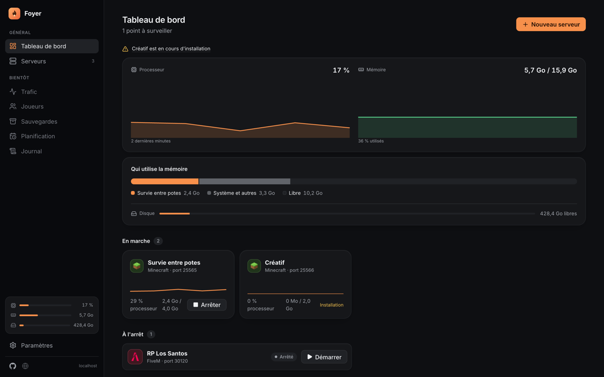
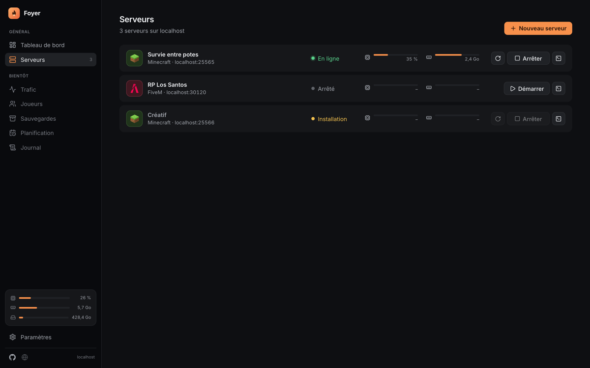
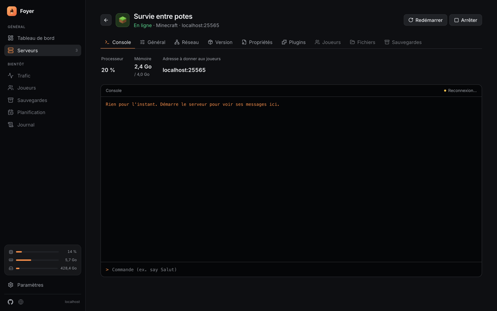
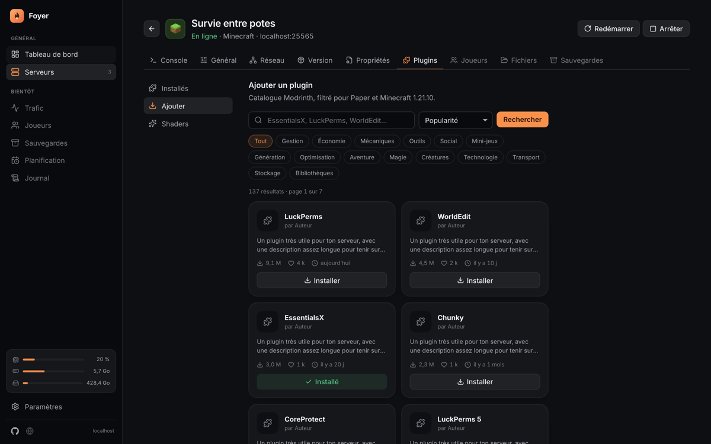
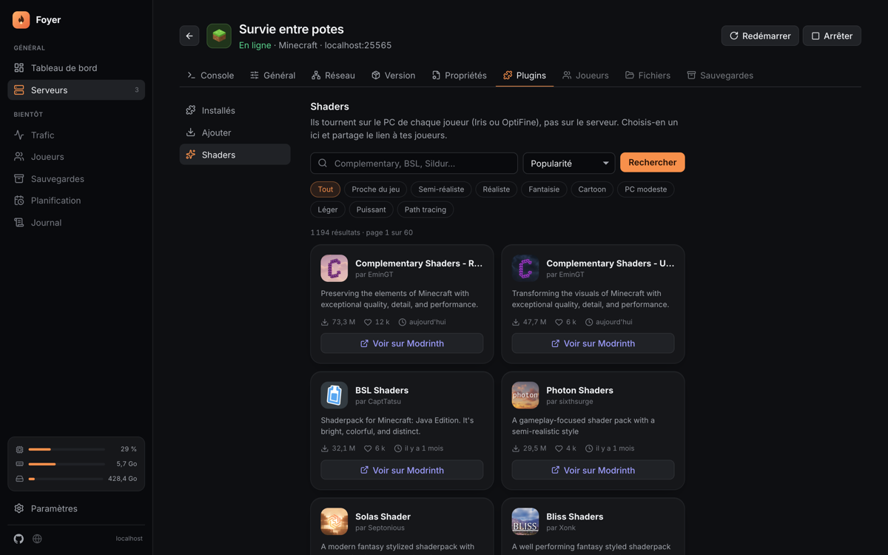
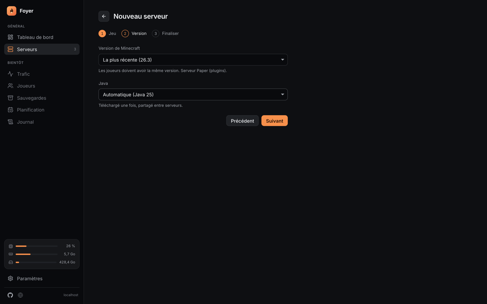
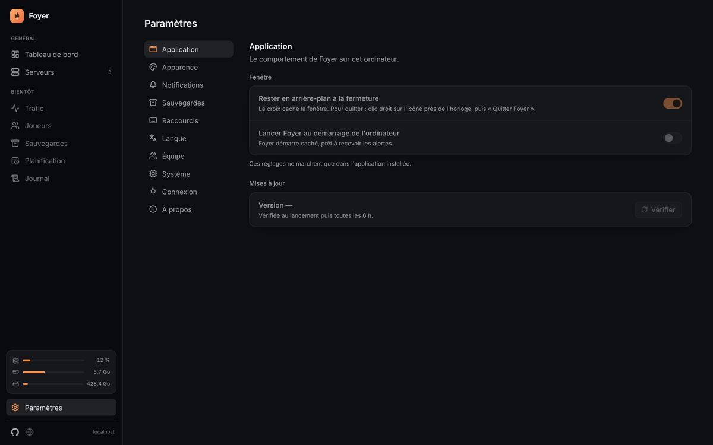

<p align="center">
  
</p>

<h1 align="center">Foyer</h1>

<p align="center">
  <strong>Gestionnaire de serveurs de jeu auto-hébergés, pour Windows et Linux.</strong><br>
  Installez, lancez et surveillez vos serveurs de jeu depuis une application de bureau claire.
</p>

<p align="center">
  <a href="README.md">English</a> · <strong>Français</strong> · <a href="README.es.md">Español</a>
</p>

<p align="center">
  <a href="https://github.com/arayan48/foyer/releases/latest"></a>
  <a href="LICENSE"></a>
  
  
</p>

<p align="center">
  
</p>

---

## Présentation

Foyer transforme n'importe quelle machine Windows ou Linux en hébergeur de serveurs de jeu, sans fichier de configuration ni ligne de commande. Un **agent** léger écrit en Rust fait le travail sur la machine. Une **application de bureau** (Tauri + Svelte) donne un tableau de bord, des consoles en direct et les réglages de chaque serveur.

### Jeux pris en charge

| Jeu | État | Source |
|---|---|---|
| Minecraft (Paper) | ✅ Pris en charge | PaperMC, dernière version stable + Java 25 (Adoptium) |
| FiveM (txAdmin) | ✅ Pris en charge | Build officiel « recommandé » |
| D'autres jeux | 🗺️ Prévu | Foyer repose sur un système de recettes pensé pour de nouveaux jeux, voir [ROADMAP.md](ROADMAP.md) |

## Fonctionnalités

- **Installation en un clic** : télécharge le serveur du jeu et ce qu'il lui faut, prêt à lancer.
- **Cycle de vie complet** : démarrer, arrêter, redémarrer, avec arrêt propre et nettoyage des processus.
- **Plugins** : catalogue Modrinth dans l'appli, filtres par catégorie, tri par popularité ou par date, installation, activation et suppression des plugins Paper.
- **Shaders** : parcourez les shaders Modrinth et partagez-les avec vos joueurs.
- **Console en direct** : journaux et commandes en temps réel par WebSocket.
- **Surveillance** : processeur et mémoire par serveur, processeur, mémoire et disque de la machine.
- **Fiabilité** : démarrage avec la machine, relance après un plantage (3 essais par 10 min).
- **Limites de ressources** : plafonds de mémoire et de processeur par serveur.
- **Pare-feu géré** : ports ouverts et fermés automatiquement.
- **Sécurisé par défaut** : HTTPS avec certificat auto-signé épinglé, jeton sur chaque route.
- **À distance ou en local** : pilotez la machine depuis un autre PC, ou directement sur le serveur.

## Captures d'écran

| | |
|---|---|
|  |  |
| **Serveurs** : état, processeur et mémoire d'un coup d'œil | **Console** : journaux et commandes en temps réel |
|  |  |
| **Plugins** : catalogue Modrinth avec filtres et pages | **Shaders** : choisissez-en un pour vos joueurs |
|  |  |
| **Nouveau serveur** : jeu, version, c'est prêt | **Paramètres** : application, mises à jour, machine |

## Architecture

```
  Votre PC                              Machine serveur
 ┌──────────────────┐   HTTPS + WSS    ┌───────────────────────────────────┐
 │  Appli Foyer     │ ───────────────▶ │  foyer-agent (port 7878)          │
 │  Tauri + Svelte  │   jeton Bearer   │   ├─ API REST  /api/...           │
 └──────────────────┘   cert. épinglé  │   ├─ console WebSocket            │
                                       │   ├─ stats système et processus   │
                                       │   └─ serveurs de jeu (processus)  │
                                       └───────────────────────────────────┘
```

| Composant | Dossier | Technologies |
|---|---|---|
| Agent | [`agent/`](agent) | Rust, axum, rustls |
| Application | [`app/`](app) | Tauri 2, Svelte 5, TypeScript |

Tous les détails : [docs/ARCHITECTURE.md](docs/ARCHITECTURE.md).

## Installation

Téléchargez depuis la [dernière version](https://github.com/arayan48/foyer/releases/latest) :

| Installeur | À installer sur | Contenu |
|---|---|---|
| `Foyer-Serveur.exe` | La machine qui héberge les jeux | Appli + agent, service au démarrage, règle de pare-feu |
| `Foyer-Client.exe` | Tout PC depuis lequel vous gérez | Appli seule, sans droits administrateur |

**Première connexion :** entrez l'adresse de la machine et le jeton de `C:\Foyer\token`. Avant d'accepter, comparez l'empreinte affichée par l'appli avec `C:\Foyer\fingerprint` sur la machine.

## Sécurité

- Tout le trafic est chiffré (TLS), l'appli épingle le certificat de l'agent.
- Chaque route, WebSocket compris, exige le jeton dans l'en-tête `Authorization`.
- **N'exposez jamais le port 7878 sur Internet.** Pour jouer ou gérer à distance, utilisez un VPN ou un tunnel comme playit.gg.

## Configuration

| Variable | Par défaut | Rôle |
|---|---|---|
| `FOYER_DATA` | `C:\Foyer` / `/var/lib/foyer` | Dossier des données (jeton, certificat, serveurs) |
| `FOYER_ADDR` | `0.0.0.0:7878` | Adresse d'écoute de l'agent |

## Compiler depuis les sources

**Agent**

```bash
cd agent
cargo build --release                                  # Linux
cargo build --release --target x86_64-pc-windows-gnu   # Windows (croisé, mingw-w64)
```

**Application**

```bash
cd app
npm install
npx tauri build                                                     # plateforme courante
npx tauri build --runner cargo-xwin --target x86_64-pc-windows-msvc # Windows depuis Linux
```

**Travailler l'interface sans serveur**

```bash
cd app
node mock-agent.mjs   # faux agent, jeton : test
npx vite
```

## Feuille de route

Ensuite : sauvegardes et tâches planifiées, gestion des joueurs, analyse du trafic, mods, puis d'autres jeux. Voir [docs/PLAN.md](docs/PLAN.md) et [ROADMAP.md](ROADMAP.md).

## Contribuer

Les bugs et les idées sont les bienvenus dans les [Issues](https://github.com/arayan48/foyer/issues). Pour le code, ouvrez une pull request sur `main`.

## Licence

[MIT](LICENSE)
